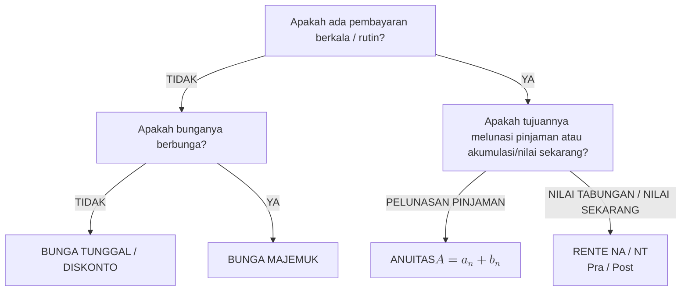

---
title:
---
# Ringkasan Matematika Keuangan Lanjutan

File ini berisi rangkuman rumus, rumus cepat, tabel perbandingan, dan panduan identifikasi skema perhitungan Matematika Keuangan untuk keperluan *review* dan rujukan cepat di Obsidian.

---

### 1. Bunga Tunggal dan Diskonto

* **Bunga Tunggal:**
  $$B = M_0 \times i \times n \qquad \implies \qquad M_n = M_0(1 + i \times n)$$

* **Diskonto:**
  $$D = M_0 \times i \times n \qquad \implies \qquad M_{\text{bersih}} = M_0(1 - i \times n)$$

* **Operasi Persen Khusus:**
  $$\text{Persen di Atas } 100 = \frac{p}{100 + p} \times M_n \qquad (\text{Mencari } B \text{ dari } M_n)$$
  $$\text{Persen di Bawah } 100 = \frac{p}{100 - p} \times M_{\text{bersih}} \qquad (\text{Mencari } D \text{ dari } M_{\text{bersih}})$$

* **Metode Bunga Tunggal Harian ($1 \text{ Tahun} = 360 \text{ Hari}$):**
  $$AB = \frac{M_0 \times t}{100}, \qquad PT = \frac{360}{i\%}, \qquad B = \frac{\sum AB}{PT}$$

---

### 2. Bunga Majemuk

* **Modal Akhir ($M_n$):**
  $$M_n = M_0(1 + i)^n$$

* **Pemajemukan $m$ Kali dalam Setahun:**
  $$M_n = M_0 \left(1 + \frac{i}{m}\right)^{n \times m}$$

* **Masa Bunga Pecahan ($n + k$, dengan $0 < k < 1$):**
  $$M_{n+k} = M_0(1 + i)^n \cdot (1 + k \cdot i) \quad \text{(Metode Praktis)}$$

---

### 3. Matriks Matriks Rumus Rente

| Jenis Rente | Waktu Pembayaran | Nilai Akhir ($NA$) — *Future Value* | Nilai Tunai ($NT$) — *Present Value* |
| :--- | :--- | :--- | :--- |
| **Pra-Numerando** | Awal Periode | $NA = \dfrac{M \cdot (1 + i) \cdot \left((1 + i)^n - 1\right)}{i}$ | $NT = \dfrac{M \cdot (1 + i) \cdot \left(1 - (1 + i)^{-n}\right)}{i}$ |
| **Post-Numerando** | Akhir Periode | $NA = \dfrac{M \cdot \left((1 + i)^n - 1\right)}{i}$ | $NT = \dfrac{M \cdot \left(1 - (1 + i)^{-n}\right)}{i}$ |
| **Kekal Pra-Numerando** | Awal ($n \to \infty$) | $-$ | $NT = \dfrac{M \cdot (1 + i)}{i}$ |
| **Kekal Post-Numerando**| Akhir ($n \to \infty$) | $-$ | $NT = \dfrac{M}{i}$ |

> [!important] Hubungan Nilai Pra dan Post
> $$NA_{\text{pra}} = NA_{\text{post}} \times (1 + i) \qquad \text{dan} \qquad NT_{\text{pra}} = NT_{\text{post}} \times (1 + i)$$

---

### 4. Anuitas dan Pelunasan Pinjaman

* **Komponen Anuitas:**
  $$A = a_n + b_n \qquad \text{dengan} \quad b_1 = M \times i$$

* **Hubungan Antar-Angsuran Pokok:**
  $$a_n = a_1 (1 + i)^{n-1}$$

* **Rumus Nilai Anuitas dari Pinjaman Awal ($M$):**
  $$A = \frac{M \cdot i}{1 - (1 + i)^{-n}}$$

* **Rumus Sisa Pinjaman ($S_n$):**
  $$S_n = \frac{b_{n+1}}{i} \qquad \text{atau} \qquad S_n = M - \frac{a_1 \left((1 + i)^n - 1\right)}{i}$$

* **Anuitas Obligasi:**
  $$k_n = \left\lfloor \frac{A - b_n}{N} \right\rceil, \qquad a_n = k_n \times N, \qquad A_n = a_n + b_n$$

---

### 5. Panduan Cepat Memilih Rumus Soal Cerita

--- 
## Konsep Terkait 
- [[00 - Peta Konsep Matematika Keuangan]] 
- [[10 - Latihan Terpadu Matematika Keuangan]]